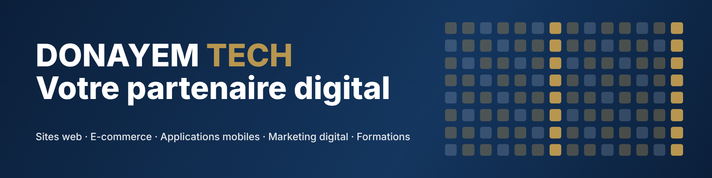
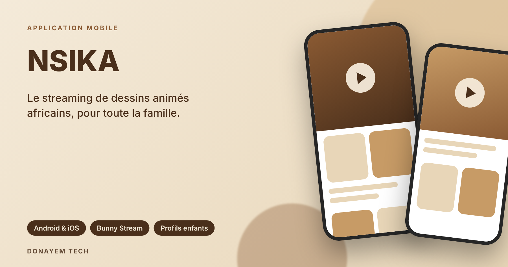
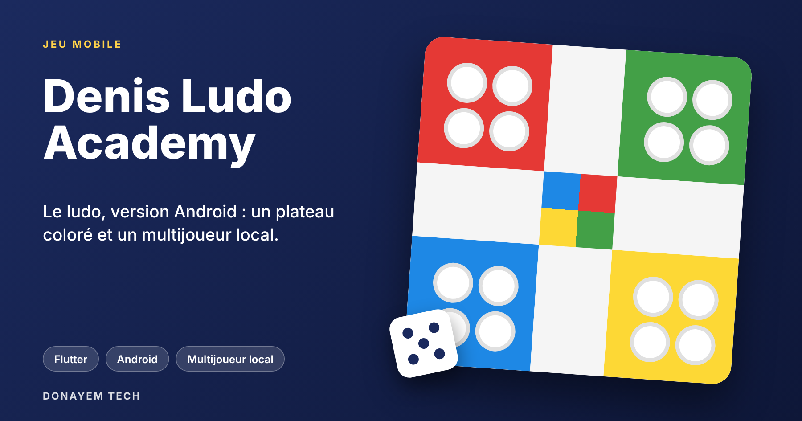
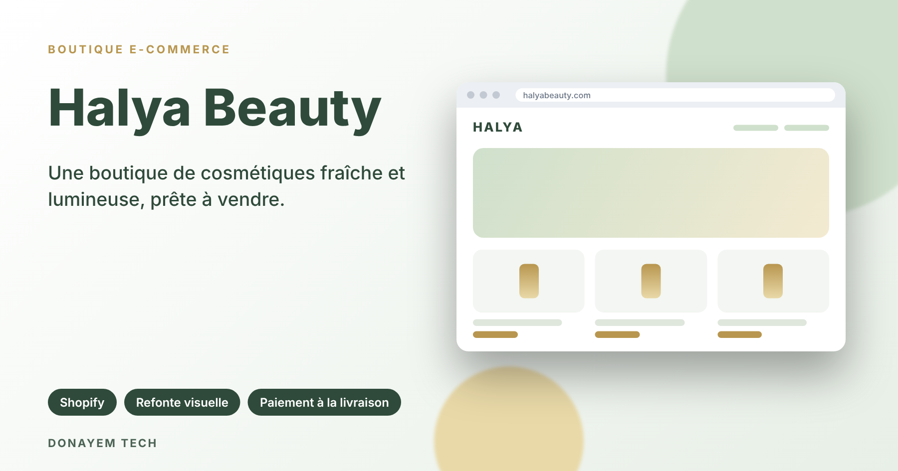
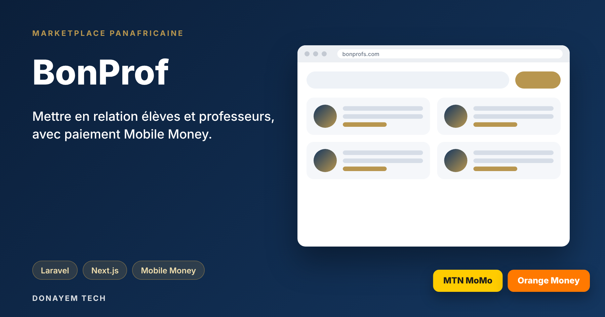
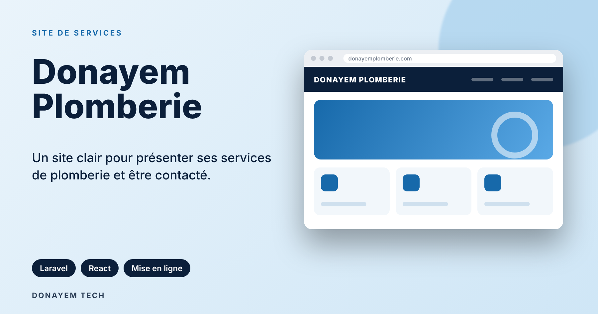

  

# DONAYEM TECH — Votre partenaire digital 🇨🇲

**DONAYEM TECH SARL** est une agence digitale basée à Douala (Cameroun). Nous concevons des **sites web**, des **boutiques e-commerce**, des **applications mobiles** et accompagnons les entreprises en **marketing digital**. Nous proposons aussi des **formations pratiques avec attestation**.

*DONAYEM TECH is a digital agency based in Douala, Cameroon: websites, e-commerce, mobile apps, digital marketing and hands-on training.*

---

## Nos services

| | |
|---|---|
| 🌐 **Sites web** | Sites vitrines et plateformes sur mesure, bilingues FR/EN, adaptés au téléphone |
| 🛒 **E-commerce** | Boutiques en ligne (Shopify, Laravel / Next.js), paiement à la livraison et Mobile Money |
| 📱 **Applications mobiles** | Applications Android et iOS, de la conception à la publication sur les stores |
| 📣 **Marketing digital** | Réseaux sociaux, visuels, fiche Google Business Profile |
| 🎓 **Formations** | Formations pratiques avec attestation : web design, Excel et bureautique, marketing |

## Réalisations

> Les visuels ci-dessous sont des illustrations aux couleurs de chaque projet, pas des captures d'écran.

### NSIKA — Application mobile de streaming

Application mobile de streaming de **dessins animés africains** pour toute la famille. Lecture vidéo via Bunny Stream, abonnement géré sur le site web, profils enfants sans publicité, espaces créateur et administrateur sur le web. Application unique pour **Android et iOS**.
**Statut :** en développement. · **Technologies :** application cross-platform, Bunny Stream.

### Denis Ludo Academy — Jeu de ludo

Application de **jeu de ludo pour Android** : plateau coloré avec un couloir par couleur et **multijoueur local** (hors ligne). Le prototype est conçu comme la base de l'application finale.
**Statut :** version 1 en développement. · **Technologies :** Flutter.

### Halya Beauty — Boutique de cosmétiques

Boutique en ligne **Shopify** : [halyabeauty.com](https://halyabeauty.com/). Refonte visuelle « frais et lumineux », mise en place du **paiement à la livraison**, fiches produits et présence sur Google Business Profile.
**Technologies :** Shopify.

### BonProf — Marketplace de cours particuliers

Plateforme **panafricaine** de mise en relation entre élèves et professeurs ([bonprofs.com](https://bonprofs.com/)). Paiement **Mobile Money** via pawaPay, réservation avec paiement sécurisé en séquestre, choix du pays et de l'opérateur, base de connaissances pour le support.
**Technologies :** Laravel, Next.js, pawaPay.

### Donayem Plomberie — Site de services

Site de services de plomberie avec espace d'administration : [donayemplomberie.com](https://donayemplomberie.com/). Mise à l'identité de marque, déploiement et mise en ligne.
**Technologies :** Laravel, React.

## Technologies

`Next.js` · `React` · `Laravel` · `MySQL` · `Tailwind CSS` · `Flutter` · `Shopify` · `WordPress` · `Mobile Money (MTN MoMo, Orange Money)`

## Nous contacter

- 📧 [contact@donayemtech.com](mailto:contact@donayemtech.com)
- 📞 WhatsApp : +237 681 18 14 56 / 696 58 04 87
- 🌍 [donayemtech.com](https://www.donayemtech.com/fr)
- 🎵 [TikTok @donayemtech](https://www.tiktok.com/@donayemtech)
- 📍 Ange Raphaël – Hôtel Select, Douala, Cameroun
- 🕗 Lundi – samedi, 08h00 – 17h00

*Partenaires, clients, étudiants : parlons de votre projet.*
